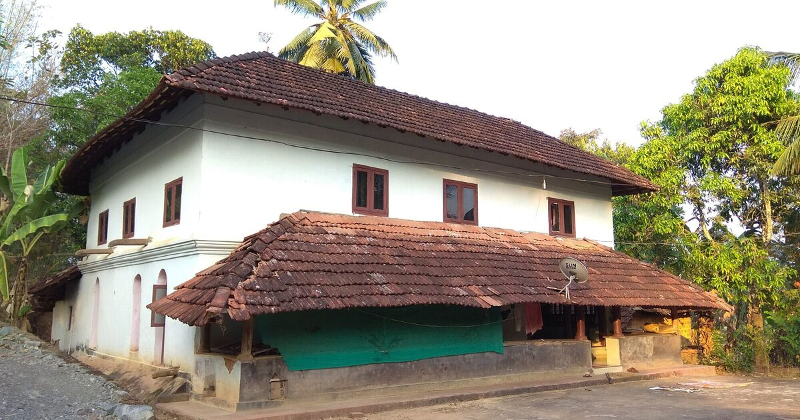

# Aranya — resort website concept

A complete website for **Aranya**, a fictional family homestay in the hills of Wayanad, Kerala. It covers everything a guest needs before booking: the house, rooms, food and days out, a photo gallery, directions and FAQs, and a stay planner that hands off to a booking site.



> **Concept site.** Aranya, its hosts, guest reviews, ratings, prices and phone number are all made up. Nothing on the site can be booked. Photos are free-licence images from Wikimedia Commons; see [photo credits](docs/photo-credits.md).

## Highlights

- **Motion with restraint.** GSAP scroll reveals, image wipes and staggered cards, all switched off for visitors who ask for reduced motion.
- **Stay planner.** Dates, guests, room choice and requests, with validation, a sample price breakdown, and choices kept for the session so a refresh doesn't lose them.
- **Accessible gallery.** Grouped photos open in a viewer that works with buttons, arrow keys, Escape and swipe.
- **Content kept apart from layout.** All copy lives in typed files under `content/`, so pages stay small and the text is easy to change.
- **Tested in a real browser.** Playwright tests cover every page, the planner, the gallery viewer, mobile navigation and 404s.

## Pages

| Route | What's there |
| --- | --- |
| `/` | Hero, introduction, rooms, food, nearby places, host story, reviews, gallery preview |
| `/stay`, `/stay/[slug]` | Room comparison and room detail pages |
| `/experiences` | Meals, time at the house, 12 places nearby with distances |
| `/gallery` | Photo groups with a full-screen viewer |
| `/location` | Address, map and directions links, FAQ |
| `/plan` | Stay planner and booking handoff |

## Stack

Next.js 16 (App Router) · React 19 · TypeScript · Tailwind CSS v4 · GSAP · Playwright

## Run it

Requires Node.js 20.9+ and npm.

```sh
npm ci
npm run dev
```

Open [localhost:3000](http://localhost:3000). For a production build: `npm run build && npm start`.

## Checks

```sh
npm run typecheck
npm run lint
npm run build
npx playwright install chromium
npm test
```

`npm test` starts a dev server on port 3000 if nothing is running. To test a production build instead, start it on another port and point the tests at it:

```sh
npm start -- --port 3028
PLAYWRIGHT_BASE_URL=http://127.0.0.1:3028 npm test
```

## Project history

This began as an unsolicited redesign for a real homestay. When the owner didn't reply, the site was rebranded as the fictional Aranya before being made public: the name, people, reviews, contact details and every property photo were replaced. The planning specs and tickets in `.scratch/` are kept to show how the work was broken down; they still describe that first version's process.
