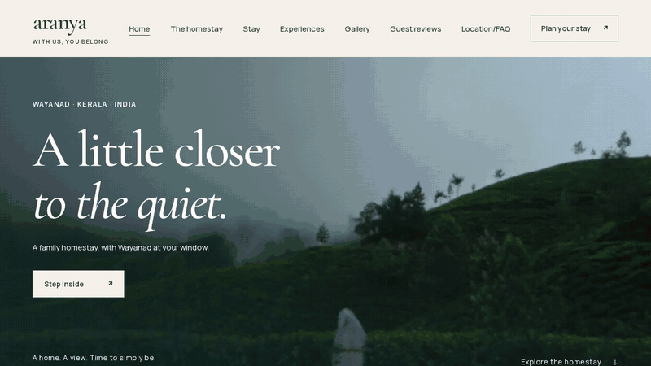

# ARANYA RESORT WEBSITE



A website for Aranya, a homestay in the hills of Wayanad, Kerala: rooms, food, days out, a photo gallery, directions and a stay planner.

> **Concept site.** Aranya, its hosts, reviews, prices and contact details are made up, and nothing can be booked. Photos are free-licence images from Wikimedia Commons ([credits](docs/photo-credits.md)).

## Tech stack

<p>
  
  
  
</p>

## How to run and check

Needs Node.js 20.9+.

```sh
npm ci
npm run dev        # http://localhost:3000
```

```sh
npx playwright install chromium   # once
npm test
```
